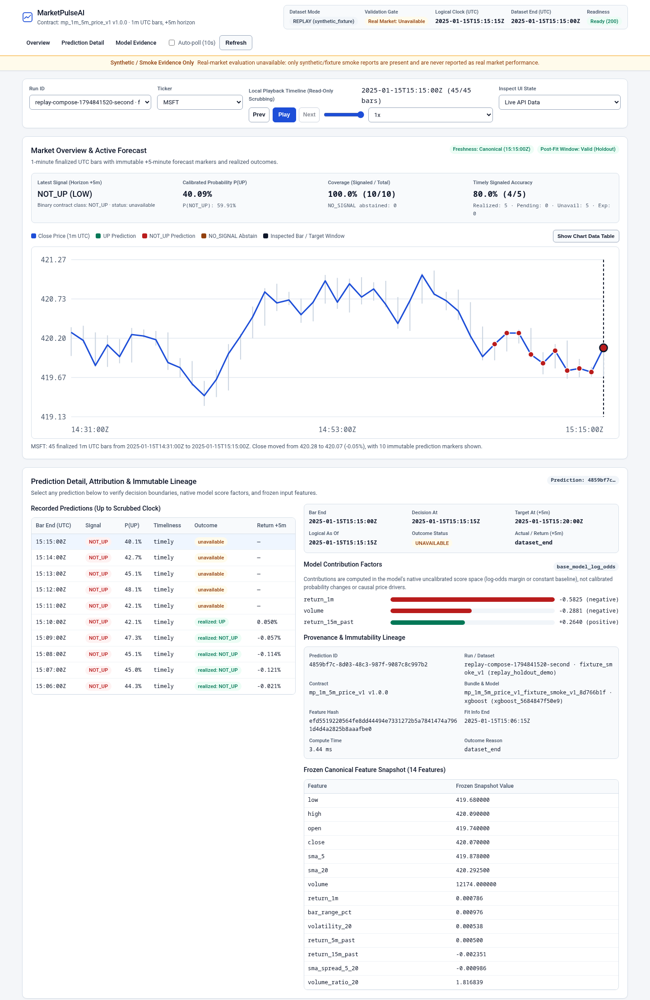
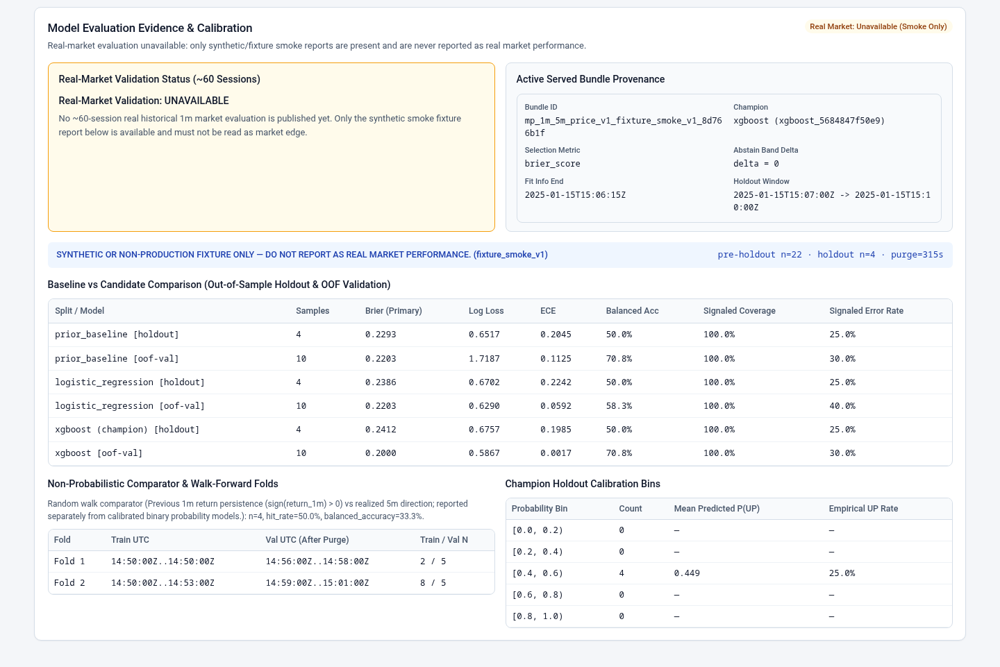
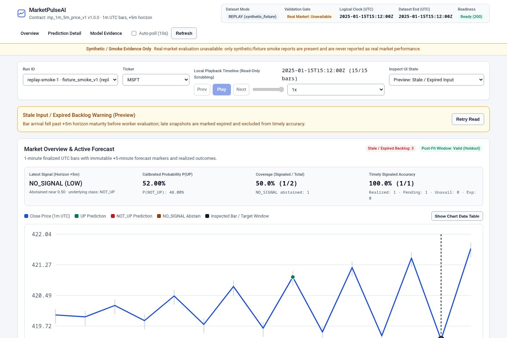
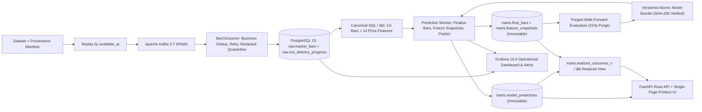

# MarketPulseAI

> **A reproducible market data pipeline with explainable predictions, time-aware evaluation, and observable failure recovery.**

[](https://github.com/Reiii0-0/MarketPulseAI/actions/workflows/ci.yml)


**Quick Links:** [101-Second Demo Video (`reports/portfolio/marketpulseai_demo.mp4`)](reports/portfolio/marketpulseai_demo.mp4) · [Engineering Case Study (`CASE_STUDY.md`)](CASE_STUDY.md) · [Release Evidence Manifest (`reports/verification/release_evidence_manifest.md`)](reports/verification/release_evidence_manifest.md)

---

## Visual Walkthrough

### 1. Product View — Market Overview, Forecast Horizon, and Immutable Prediction Lineage


### 2. Model Evidence — Purged Walk-Forward Comparison and Calibration


### 3. Failure Recovery & Operational Observability — Degraded State and Run Isolation


---

## Problem Statement

Streaming market analytics prototypes commonly fail three engineering checks:

1. **Silent future leakage:** Computing rolling indicators or `LEAD(close)` targets over mutable raw tables allows late events to rewrite historical features after a prediction has been published.
2. **Train-serving skew:** Maintaining separate SQL queries for analytics and Python scripts for training causes indicator values and warm-up rules to diverge between training and serving.
3. **Unverifiable ML and operational claims:** Demos frequently require paid provider keys to boot, substitute random-walk mock prices when an API quota fails, or tune hyperparameters on the final test split.

MarketPulseAI addresses these three problems on a single-host Docker Compose stack:

- **One explicit forecast contract (`config/forecast_contract.json`):** 1-minute UTC OHLCV bars (`bar_interval_seconds=60`), +5-minute directional target (`UP` when `close(t+5m) > close(t)`, `NOT_UP` otherwise, flat ties mapped to `NOT_UP`), 15-second arrival grace window, and 20-bar contiguous warm-up per regular session (`America/New_York` 09:30–16:00).
- **One SQL feature authority + write-once snapshots:** PostgreSQL SQL (`CANONICAL_FINAL_BAR_FEATURES_SQL` in `pipeline/features.py`, exposed through dbt models) computes all 14 price features from finalized bars (`marts.final_bars`) and freezes them into `marts.feature_snapshots` (`ON CONFLICT DO NOTHING`) with a SHA-256 `feature_hash`.
- **Availability-ordered replay with delivery barriers:** `ReplayCoordinator` publishes batches ordered by `available_at`, waits for PostgreSQL offset barriers (`raw.run_delivery_progress`) across partitions before advancing the run's `logical_as_of` clock, and drains the final bar's grace window via empty decision steps.
- **Purged walk-forward evaluation without holdout tuning:** `model/evaluate.py` enforces a 315-second label maturity purge (`300 s` horizon + `15 s` grace) between splits, compares `prior_baseline`, `logistic_regression`, and `xgboost` on Brier score, fits Platt calibration and `NO_SIGNAL` abstention on out-of-fold validation only, and evaluates the final holdout once.

---

## Architecture



### Write Ownership

| Layer | Owner | Target Relations | Guarantee |
|---|---|---|---|
| **Ingestion & Quarantine** | `consumer/bar_consumer.py` (`BaseConsumer`) | `raw.market_bars`, `raw.ingestion_quarantine`, `raw.run_delivery_progress` | Single DB transaction per Kafka message before offset commit; business dedup on `(dataset_id, source_event_id)`; Pydantic inputs redacted before quarantine write. |
| **Bar Finalization & Feature Freezing** | `pipeline/worker.py` (`BarFinalizationEngine`) | `marts.final_bars`, `marts.late_bar_corrections`, `marts.feature_snapshots` | Write-once (`ON CONFLICT DO NOTHING`) scoped by `run_id`; arrivals after `bar_end + 15s` routed to `marts.late_bar_corrections`. |
| **Inference & Checkpointing** | `pipeline/worker.py` (`advance_run`) | `marts.model_predictions`, `marts.prediction_worker_state` | Single worker lease per `run_id`; verifies bundle SHA-256 and `feature_hash`; never backdates live backlog past `target_at`. |
| **Analytical Views & Data Tests** | `dbt_project/` (`dbt-postgres 1.7`) | `staging.*`, `intermediate.*`, `marts.*` (`11` models, `116` tests) | Non-mutating SQL views over canonical snapshots and `marts.realized_outcomes_v`. |
| **Product Serving** | `api/` (`FastAPI`) | Read-only `GET /api/v1/{runs,bars,predictions,outcomes,evidence,tickers}` | Browser refresh never triggers inference; `API_READONLY_DEMO=true` blocks all non-`GET` methods with `403`. |

---

## Quickstart (Zero API Keys Required)

### Prerequisites
- Docker Engine & Docker Compose v2
- Python 3.11 & [`uv`](https://docs.astral.sh/uv/)

### 1. Run the End-to-End Deterministic Replay Demo
From a clean clone, run one command:

```bash
make demo
```

`make demo` (`scripts/demo.py`) performs the following steps without wiping existing volumes:
1. Creates `.env` from `.env.example` if missing and selects free loopback ports automatically if defaults (`5432`, `9092`, `8000`, `3000`) are occupied.
2. Verifies or builds the deterministic smoke evaluation bundle (`model/artefacts/current`) from `data/fixtures/smoke_1m_v1.csv`.
3. Starts `postgres` and `kafka`, initializes Kafka topics (`init-kafka`), and applies additive SQL migrations (`scripts/migrations/001`–`005`).
4. Starts `bar-consumer`, `dbt-runner`, `api`, `prediction-worker`, `grafana`, and `producer` (`replay_producer.py`).
5. Waits until `/health/ready` returns HTTP `200` and the worker writes predictions for the replay run, then executes `dbt run && dbt test` (`11` models + `116` data quality checks) and prints the active URLs and timing breakdown (`reports/verification/demo_bootstrap.json`).

### 2. Run Offline Checks and Browser / Compose Suites

```bash
# Install locked dependencies
uv sync --locked --extra dev --extra e2e

# Fast static checks and offline unit + API integration suite (138 passed, ~35s)
make lint
make typecheck
make test

# Headless browser E2E verification (Playwright Chromium + Brave if installed)
make test-e2e

# Full real Docker Compose E2E, fault injection, recovery, dbt, Grafana, and benchmark suite
make test-compose
```

---

## Data Sources and Licensing Boundaries

| Dataset / Mode | Provenance Tag | Coverage | Redistribution & Usage Policy |
|---|---|---|---|
| **`fixture_smoke_v1`** (`data/fixtures/smoke_1m_v1.csv`) | `synthetic_fixture` | 89 1-minute bars (`MSFT`: 45, `AAPL`: 44) across regular session, gap, and warm-up edge cases | MIT-licensed synthetic fixture committed to this repository for deterministic CI and offline `make demo`. Never reported as real market performance (`real_market_validated: false`). |
| **Kibot Unadjusted Intraday Sample (`IBM`)** | `real_historical` | **24,531** 1-minute bars across **63 trading sessions** (3 walk-forward folds, `17,865` pre-holdout samples, `4,468` holdout samples) | Downloaded from Kibot's account-free historical sample for internal evaluation (`scripts/import_kibot.py`). Raw CSVs, manifests, reports, and bundles stay in gitignored `data/private/` and `reports/private/` per [Kibot's license](https://www.kibot.com/license.html). |
| **Live Provider Profile (`--profile live`)** | `real_live` | Real-time quotes (`Finnhub /api/v1/quote`) and timestamped news (`Marketaux /v1/news/all`) | Strictly free-tier APIs only. Disabled by default; when enabled, HTTP 403/rate-limit errors are recorded as `unavailable` without falling back to synthetic mock prices. |

---

## Measured Engineering & ML Results

All measurements below were recorded on **Linux 7.2.6 x86_64 (16 CPU threads, 19.21 GiB RAM, Python 3.11.16)** and are backed by machine-readable JSON artifacts in `reports/`.

### 1. System Performance, Bootstrap, and Recovery

| Benchmark / Check | Workload & Conditions | Measured Result | Evidence Artifact |
|---|---|---|---|
| **Sustained Read API Load (5 min)** | `3,000` requests over `299.9 s` (`10.0 req/s`, concurrency `4`) across 7 read endpoints with full JSON body validation | **0 errors** · Latency **p50 5.34 ms / p95 9.22 ms / p99 10.30 ms** · Scheduled-arrival **p95 9.30 ms** (budget ≤ 300 ms) | [`read_api_5min_20261116.json`](reports/benchmarks/read_api_5min_20261116.json) |
| **1× Four-Ticker Replay Latency** | 5-minute 1× steady-state tail (`AAPL`, `MSFT`, `NVDA`, `TSLA`, `20` predictions) after 120× warm-up | **20/20 predictions** · DB bar finalization to prediction read **p50 0.265 s / p95 0.589 s** (budget ≤ 15 s) | [`replay_latency_4ticker_20261116.json`](reports/benchmarks/replay_latency_4ticker_20261116.json) |
| **SQL vs. Python Feature Parity & Speed** | `24,531` real 1-minute `IBM` bars evaluated in PostgreSQL 15 (`EXPLAIN ANALYZE`) vs. Python reference | **0 hash mismatches** · PostgreSQL execution **394.012 ms** (`1.266 ms` planning) | `reports/private/kibot_ibm_20261116/sql_feature_profile.json` |
| **Warm / Fresh State Bootstrap** | Clean export without `.env`, `.venv`, model bundle, or prior DB volume (cached Docker images & wheels) | **57.763 s** runtime to ready predictions · **78.551 s** total including bundle prep (`9.589 s`) & dbt (`10.836 s`) (budget ≤ 120 s) | [`demo_fresh_state.json`](reports/verification/demo_fresh_state.json) |
| **Cold Download & `--no-cache` Build** | Empty `UV_CACHE_DIR` (`uv sync --no-cache`) + `docker compose build --no-cache` for all 4 custom images | **170.376 s** cold Python sync + **785.013 s** cold Docker build (**955.389 s** total), followed by **68.772 s** runtime to ready predictions | [`cold_build_and_download_20261116.json`](reports/verification/cold_build_and_download_20261116.json) |
| **Container Resource Footprint** | Sampled via `docker stats --no-stream` during sustained 10 req/s API load | `postgres`: **42.4 MiB** (`2.72%` CPU) · `api`: **287.9 MiB** (`0.10%` CPU) · `worker`: **150.5 MiB** · `bar-consumer`: **38.8 MiB** · `kafka`: **329.1 MiB** (`22.77%` CPU) · `grafana`: **126.7 MiB** | [`read_api_5min_20261116.json`](reports/benchmarks/read_api_5min_20261116.json) |
| **Fault Injection & Recovery** | Duplicate Kafka publish, malformed secret-bearing JSON, commit-gap crash, DB outage/restart, worker restart, second replay run | `89` final bars/run, `178` snapshots, `10` predictions/run, `0` duplicates, secret token redacted in `raw.ingestion_quarantine`, `11` dbt models + `116` tests green | [`repair_e2e.json`](reports/verification/repair_e2e.json) |
| **Image & Bundle Rollback** | Live switch of `api` + `prediction-worker` between two image digests and retained bundle releases without volume reset | Readiness HTTP `200` and row counts (`358` bars / `358` snapshots / `60` predictions) preserved across rollback and restore | [`image_rollback_20261116.json`](reports/verification/image_rollback_20261116.json) |
| **Read-Only TLS Proxy Overlay** | `deploy/docker-compose.demo-tls.yml` + `deploy/Caddyfile` verified with Caddy internal Root CA | **7/7 HTTPS tests passed**: `GET` read routes return `200`, `POST`/`DELETE` return `403`, `/docs` returns `404`, internal services expose zero host ports | [`tls_local_20261116.json`](reports/verification/tls_local_20261116.json) |
| **Remote GitHub Actions CI** | Full workflow on `ubuntu-latest` (`quality-and-tests`, `browser-e2e-ui`, `compose-integration-recovery`) | **3/3 jobs passed** (`47 s`, `43 s`, `9m 39s`) on run [`43906352303`](https://github.com/Reiii0-0/MarketPulseAI/actions/runs/43906352303) | [`github_ci_remote_20261116.json`](reports/verification/github_ci_remote_20261116.json) |

### 2. Time-Aware Machine Learning Evaluation (63-Session Private `IBM` Run vs. Public Smoke Fixture)

Both evaluations use contract `mp_1m_5m_price_v1` (`14` price-only features, **315-second maturity purge** between training and validation/holdout cutoffs, Brier score selection on out-of-fold validation, and a single untouched holdout evaluation):

| Dataset (`provenance`) | Split / Model | Samples | Brier Score (↓) | Log Loss (↓) | Balanced Acc | ECE | Coverage |
|---|---|---:|---:|---:|---:|---:|---:|
| **`kibot_ibm_20261116`** (`real_historical`, 63 sessions, 3 folds, holdout `2026-10-27`..`2026-11-13`) | `prior_baseline` [holdout] | 4,468 | **0.249998** | **0.693144** | 0.5000 | **0.0045** | 1.0000 |
| **`kibot_ibm_20261116`** (`real_historical`) | `xgboost` (selected on validation) [holdout] | 4,468 | 0.250077 | 0.693302 | 0.4857 | 0.0050 | 1.0000 |
| **`kibot_ibm_20261116`** (`real_historical`) | `logistic_regression` [holdout] | 4,468 | 0.250325 | 0.693798 | 0.5000 | 0.0090 | 1.0000 |
| **`fixture_smoke_v1`** (`synthetic_fixture`, 2 folds, public CI smoke test) | `xgboost` (selected on validation) [oof-val / holdout] | 10 / 4 | 0.2000 / 0.2412 | 0.5867 / 0.6757 | 0.7083 / 0.5000 | 0.0017 / 0.1985 | 1.0000 |

**Interpretation:** On the 63-session real historical dataset, `xgboost` achieved the lowest out-of-fold validation Brier score and was locked as the champion model before holdout evaluation. On the `4,468` untouched holdout bars, the constant `prior_baseline` (`0.249998`) slightly outperformed `xgboost` (`0.250077`). Per our evaluation protocol, no post-holdout hyperparameter tuning or champion swapping was performed. This result confirms that short-horizon 1-minute price indicators on a single equity do not provide a tradable market edge, while proving that the pipeline's time splits, purge barriers, and artifact hashes reproduce identically (`reports/private/kibot_ibm_20261116/reproduction_check.json`).

---

## Tradeoffs and Limitations

1. **SQL window scan vs. incremental state:** Computing rolling 20-bar features in PostgreSQL over `marts.final_bars` avoids maintaining a separate stateful stream processor and runs in `394 ms` for `24,531` bars, but sorts spill to disk at higher volumes.
2. **Single-worker per-run lease:** One worker process per `run_id` simplifies transaction boundaries and crash recovery (`marts.prediction_worker_state`), at the cost of horizontal write throughput.
3. **Historical availability assumption:** Standard intraday OHLCV archives do not include exchange packet arrival timestamps. Historical evaluation explicitly sets `available_at = bar_end + 5s` (`availability_assumed: true`) rather than claiming full point-in-time tick reconstruction.
4. **Public demo uses synthetic data:** Because free historical intraday vendors prohibit raw/derived data redistribution, the public repository and default `make demo` serve `fixture_smoke_v1` and display `Real-Market Validation: UNAVAILABLE` in the UI banner.

---

## Repository Map

```text
├── api/                        # FastAPI read-only product API, health/readiness, and static single-page UI
├── config/                     # Canonical forecast_contract.json (mp_1m_5m_price_v1)
├── consumer/                   # Kafka BarConsumer, TickConsumer, SentimentConsumer, and DatabaseManager pool
├── data/
│   ├── fixtures/               # Deterministic 1-minute OHLCV smoke fixture (smoke_1m_v1.csv)
│   └── manifests/              # Dataset SHA-256 manifests and real-dataset audit notes
├── dbt_project/                # 11 dbt SQL models (staging, intermediate, marts) and 116 schema/singular tests
├── deploy/                     # Caddyfile and docker-compose.demo-tls.yml read-only HTTPS overlay
├── model/                      # Purged walk-forward evaluator (evaluate.py), trainer (train.py), and Predictor
├── monitoring/                 # Provisioned Grafana 10.4 datasource, dashboard, and unified alert rules
├── pipeline/                   # Time contract, replay coordinator, canonical SQL/Python features, and worker
├── producer/                   # Availability-ordered replay_producer.py and free-tier live_producer.py
├── reports/                    # Verified benchmark, evaluation, recovery, and portfolio media artifacts
├── scripts/                    # demo.py bootstrap, migrations 001-005, Kibot importer, and latency benchmarks
└── tests/                      # Unit, integration, Compose recovery, local TLS, and Playwright/Brave E2E suites
```

---

## License

Code and synthetic fixtures are released under the [MIT License](LICENSE). Third-party market data and cited academic papers remain under their respective source terms and are not redistributed in this repository.
